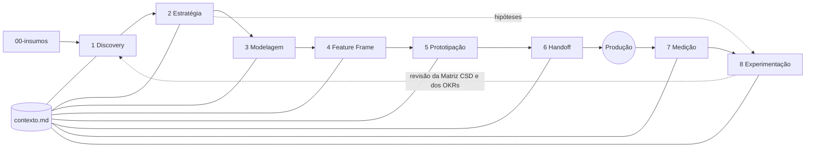

# Mapa da Esteira

Relação entre os módulos do [Guia da Esteira](guia-da-esteira.md), as skills, os agentes e os artefatos deste repositório.

## Fluxo

## Módulos, skills e agentes

| Módulo | Framework | Skill | Agente | Artefato |
| :--- | :--- | :--- | :--- | :--- |
| 1 — Discovery | Design Thinking (Empatia) | [`discovery-product-strategy`](../skills/discovery-product-strategy/SKILL.md) | [`discovery-strategist`](../agents/discovery-strategist.md) | `01-discovery.md` |
| 2 — Estratégia | Golden Circle, Lean UX | [`discovery-product-strategy`](../skills/discovery-product-strategy/SKILL.md) | [`discovery-strategist`](../agents/discovery-strategist.md) | `02-estrategia.md` |
| 3 — Modelagem | UCD | [`behavioral-modeling-feature-framing`](../skills/behavioral-modeling-feature-framing/SKILL.md) | [`experience-modeler`](../agents/experience-modeler.md) | `03-modelagem.md` |
| 4 — Feature Frame | Feature Frame, Lean Inception | [`behavioral-modeling-feature-framing`](../skills/behavioral-modeling-feature-framing/SKILL.md) | [`experience-modeler`](../agents/experience-modeler.md) | `04-feature-frames.md` |
| 5 — Prototipação | Agile Prototyping | [`systemic-ui-interaction-design`](../skills/systemic-ui-interaction-design/SKILL.md) | [`interface-designer`](../agents/interface-designer.md) | `05-prototipacao.md` |
| 6 — Handoff | Agile Handoff | [`technical-handoff-prompt-engineering`](../skills/technical-handoff-prompt-engineering/SKILL.md) | [`handoff-tech-lead`](../agents/handoff-tech-lead.md) | `06-handoff.md` |
| 7 — Medição | Heurísticas de usabilidade | [`behavioral-analytics-ux-fixes`](../skills/behavioral-analytics-ux-fixes/SKILL.md) | [`growth-analyst`](../agents/growth-analyst.md) | `07-diagnostico-comportamental.md` |
| 8 — Experimentação | Experimentação A/B/n | [`behavioral-experimentation-cro`](../skills/behavioral-experimentation-cro/SKILL.md) | [`growth-analyst`](../agents/growth-analyst.md) | `08-experimentos.md` |

Coordenação entre módulos: [`esteira-orchestrator`](../agents/esteira-orchestrator.md).

Skills de apoio, sem módulo fixo:

| Skill | Função |
| :--- | :--- |
| [`get-more-perspectives`](../skills/get-more-perspectives/SKILL.md) | Painel de 3 a 5 pontos de vista para decisões com mais de uma opção viável |
| [`match-my-writing-style`](../skills/match-my-writing-style/SKILL.md) | Aplicação do estilo de escrita do usuário em textos de comunicação |

## Diferença entre skill e agente

| | Skill | Agente |
| :--- | :--- | :--- |
| **Define** | O método: algoritmo de execução e padrão de entrega | O papel: quem executa, com quais entradas, conduta e critério de conclusão |
| **Ativação** | Automática, pela descrição, ou por nome | Delegação pelo orquestrador ou seleção pelo usuário |
| **Reuso** | Pode ser usada isoladamente em qualquer conversa | Depende das skills e dos artefatos da iniciativa |

## Passagem de contexto (Regra de Ouro)

O guia determina que cada módulo receba o resumo do anterior. Neste repositório a regra é implementada por arquivo:

1. Cada iniciativa tem uma pasta `iniciativas/<slug>/`.
2. Cada módulo grava um artefato numerado nessa pasta.
3. Ao concluir, o módulo atualiza `contexto.md` com o resumo do que foi decidido.
4. O módulo seguinte lê `contexto.md` antes de iniciar.

O campo Out of Scope é transcrito sem alteração do Módulo 4 ao Módulo 6. A verificação de rastreabilidade do Módulo 6 confere essa integridade.

## Ajustes de harmonização

As skills originais foram mantidas e complementadas para cobrir o que o guia pede. Alterações em relação aos arquivos de origem:

| Skill | Acréscimo | Origem no guia |
| :--- | :--- | :--- |
| `discovery-product-strategy` | Download do Problema (cenário atual, premissas, limitações técnicas) | Módulo 1, prompt sugerido |
| `discovery-product-strategy` | Matriz de Hipóteses no formato Lean UX | Módulo 2, resultado |
| `discovery-product-strategy` | Descrição das 9 tipologias de medição de KR | Não consta no guia; explicita o que a skill já listava |
| `behavioral-modeling-feature-framing` | Motivações e medos na Protopersona; Mapa de Empatia | Módulo 3, prompt sugerido |
| `behavioral-modeling-feature-framing` | Esforço em Fibonacci e matriz de priorização | Módulo 4, prompt sugerido |
| `systemic-ui-interaction-design` | Fluxo de telas, wireframe descritivo e Guia de UI para assistente de código | Módulo 5, prompt sugerido |
| `technical-handoff-prompt-engineering` | Infraestrutura e integrações; verificação de rastreabilidade | Módulo 6, prompt sugerido |
| `behavioral-analytics-ux-fixes` | Nível de evidência por achado; encaminhamento para correção direta ou experimento | Não consta no guia |
| `behavioral-experimentation-cro` | Parâmetros estatísticos, critério de parada e critério de decisão | Não consta no guia |
| `match-my-writing-style` | Alternativa sem conector do Workspace (`voice-card.md` local) | Necessário para uso fora do Gemini |
| Todas as de processo | Entradas, saídas, regras de execução e passagem de contexto | Regra de Ouro |

Pontos em que guia e skills divergem e a decisão adotada:

| Tema | Guia | Skill original | Decisão |
| :--- | :--- | :--- | :--- |
| OKRs | "Proponha 3 OKRs" | 1 Objetivo com 3 Key Results | Padrão de 1 Objetivo com 3 KRs; até 3 Objetivos quando houver mais de uma frente estratégica |
| Ordem dos Módulos 4 e 5 | No cronograma de 2 dias, o Módulo 5 ocorre antes do Módulo 4 | A skill de UI recebe Feature Frames como entrada | Execução com agentes segue 3 → 4 → 5; o cronograma presencial permanece como no guia |
| Módulos 7 e 8 | Não existem | Skills de analytics e experimentação | Adicionados como ciclo pós-entrega, com retroalimentação ao Módulo 1 |
| Assistente de código | Copilot | Cursor e GitHub Copilot | System Prompt neutro, aplicável a qualquer assistente |
