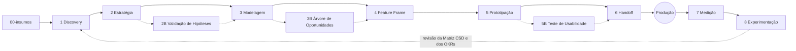

# Mapa da Esteira

Relação entre os módulos do [Guia da Esteira](guia-da-esteira.md), as skills, os agentes e os artefatos deste repositório.

## Fluxo

Linhas tracejadas indicam etapas opcionais e retroalimentação. `contexto.md` é lido e atualizado em todos os módulos; a revisão independente ocorre ao fim de cada um.

## Módulos, skills e agentes

| Módulo / Etapa | Framework | Skill | Agente | Artefato |
| :--- | :--- | :--- | :--- | :--- |
| 1 — Discovery | Design Thinking (Empatia) | [`discovery-product-strategy`](../skills/discovery-product-strategy/SKILL.md) | [`discovery-strategist`](../agents/discovery-strategist.md) | `01-discovery.md` |
| 2 — Estratégia | Golden Circle, Lean UX | [`discovery-product-strategy`](../skills/discovery-product-strategy/SKILL.md) | [`discovery-strategist`](../agents/discovery-strategist.md) | `02-estrategia.md` |
| 2B — Validação de Hipóteses (opcional) | Lean UX | [`hypothesis-validation-research`](../skills/hypothesis-validation-research/SKILL.md) | [`discovery-strategist`](../agents/discovery-strategist.md) | `02b-validacao-hipoteses.md` |
| 3 — Modelagem | UCD | [`behavioral-modeling-feature-framing`](../skills/behavioral-modeling-feature-framing/SKILL.md) | [`experience-modeler`](../agents/experience-modeler.md) | `03-modelagem.md` |
| 3B — Árvore de Oportunidades (opcional) | Opportunity Solution Tree | [`behavioral-modeling-feature-framing`](../skills/behavioral-modeling-feature-framing/SKILL.md) | [`experience-modeler`](../agents/experience-modeler.md) | `03b-arvore-oportunidades.md` |
| 4 — Feature Frame | Feature Frame, Lean Inception | [`behavioral-modeling-feature-framing`](../skills/behavioral-modeling-feature-framing/SKILL.md) | [`experience-modeler`](../agents/experience-modeler.md) e [`handoff-tech-lead`](../agents/handoff-tech-lead.md) (viabilidade) | `04-feature-frames.md` |
| 5 — Prototipação | Agile Prototyping | [`systemic-ui-interaction-design`](../skills/systemic-ui-interaction-design/SKILL.md) | [`interface-designer`](../agents/interface-designer.md) | `05-prototipacao.md` |
| 5B — Teste de Usabilidade (opcional) | Teste baseado em tarefas | [`prototype-usability-testing`](../skills/prototype-usability-testing/SKILL.md) | [`interface-designer`](../agents/interface-designer.md) | `05b-teste-usabilidade.md` |
| 6 — Handoff | Agile Handoff | [`technical-handoff-prompt-engineering`](../skills/technical-handoff-prompt-engineering/SKILL.md) | [`handoff-tech-lead`](../agents/handoff-tech-lead.md) | `06-handoff.md` |
| 7 — Medição | Heurísticas de usabilidade | [`behavioral-analytics-ux-fixes`](../skills/behavioral-analytics-ux-fixes/SKILL.md) | [`growth-analyst`](../agents/growth-analyst.md) | `07-diagnostico-comportamental.md` |
| 8 — Experimentação | Experimentação A/B/n | [`behavioral-experimentation-cro`](../skills/behavioral-experimentation-cro/SKILL.md) | [`growth-analyst`](../agents/growth-analyst.md) | `08-experimentos.md` |
| Revisão independente | — | [`artifact-evidence-review`](../skills/artifact-evidence-review/SKILL.md) | [`artifact-reviewer`](../agents/artifact-reviewer.md) | `revisoes.md` |

Componentes sem agente:

| Skill | Função |
| :--- | :--- |
| [`esteira-orchestration`](../skills/esteira-orchestration/SKILL.md) | Coordenação: trilha, delegação, revisão e aprovações |
| [`pocket-feature-frame`](../skills/pocket-feature-frame/SKILL.md) | Trilha pocket: ajuste pequeno em um único documento |
| [`get-more-perspectives`](../skills/get-more-perspectives/SKILL.md) | Painel de 3 a 5 pontos de vista para decisões com mais de uma opção viável |
| [`match-my-writing-style`](../skills/match-my-writing-style/SKILL.md) | Aplicação do estilo de escrita do usuário em textos de comunicação |

## Trilha pocket

Para ajustes pequenos em produto existente. Condensa os Módulos 1 a 7 em um único documento curto, produzido por uma única skill, sem agentes.

| Bloco do documento | Módulo de origem | O que resta |
| :--- | :--- | :--- |
| 0. Triagem | — | Sete critérios de entrada; um "Não" encaminha para a trilha expressa |
| 1. Problema e evidência | 1 — Discovery | Uma evidência obrigatória; suposição declarada |
| 2. Resultado esperado | 2 — Estratégia | Uma métrica, vinculada a Key Result existente |
| 3. Feature Frame | 4 — Feature Frame | Um único frame, com Out of Scope |
| 4. Interface | 5 — Prototipação | Somente o que muda: antes e depois |
| 5. Handoff | 6 — Handoff | Uma issue com três cenários BDD, incluindo não regressão |
| 6. Verificação pós-entrega | 7 — Medição | O que conferir, onde e quando |

O Módulo 3 não tem bloco próprio: a trilha pocket usa a modelagem já existente na iniciativa. Critérios de triagem (todos devem ser atendidos): um único ponto do fluxo; uma única issue com esforço até 5; sem dados pessoais novos; sem integração nem mudança de modelo de dados; reversível; sem alteração de Visão, OKRs ou Out of Scope vigente; ao menos uma evidência.

## Trilhas e impacto no prazo

| Etapa | Obrigatória | Impacto no prazo | Motivo |
| :--- | :--- | :--- | :--- |
| Módulos 1 a 6 | Sim | Base da imersão de 2 dias | — |
| Checagem de viabilidade técnica (Módulo 4) | Sim | Baixo | Feita por agente na mesma sessão; confirmação do time no Módulo 6 |
| Pontuação de valor e confiança (Módulo 4) | Sim | Baixo | Três campos por Feature Frame |
| Plano de instrumentação e dados pessoais (Módulos 1 e 6) | Sim | Baixo | Seções adicionais em artefatos existentes |
| Revisão independente e registro de aprovação | Sim | Baixo | Execução por agente; aprovação já era necessária |
| 2B — Validação de Hipóteses | Não | Dias | Exige coleta com pessoas ou dados |
| 3B — Árvore de Oportunidades | Não | Horas | Exige gerar e comparar soluções alternativas |
| 5B — Teste de Usabilidade | Não | Dias | Exige recrutamento e sessões |

As estimativas de impacto são qualitativas; não foram medidas em execuções reais.

## Skill ou agente

| | Skill | Agente |
| :--- | :--- | :--- |
| **Define** | O método: algoritmo de execução e padrão de entrega | O papel: quem executa, com quais entradas, conduta e critério de conclusão |
| **Onde roda** | No contexto da conversa em andamento | Em contexto separado, devolvendo o resultado |
| **Ativação** | Automática, pela descrição, ou por nome | Delegação a partir da conversa principal ou seleção pelo usuário |

Critérios usados neste repositório para decidir a forma de cada componente:

| Critério | Indica |
| :--- | :--- |
| Precisa dialogar com o usuário durante a execução (escolhas, aprovações) | Skill |
| Precisa acionar outros agentes | Skill, na conversa principal |
| Precisa ser independente de quem produziu o trabalho | Agente |
| Processa insumo volumoso que não deve ocupar a conversa principal | Agente |
| É um método reutilizável fora da esteira | Skill |
| Apenas encapsula uma skill, sem contexto próprio a preservar | Skill; o agente é redundante |

Aplicação:

| Componente | Forma | Justificativa |
| :--- | :--- | :--- |
| Orquestração | Skill | Dialoga com o usuário e delega a agentes. Era agente na primeira versão; foi convertida |
| Trilha pocket | Skill | Insumo pequeno e diálogo direto com o solicitante; um contexto separado só acrescentaria custo |
| Revisão de artefatos | Skill + agente | O método é a skill; a independência exige o contexto separado do agente |
| `discovery-strategist`, `growth-analyst` | Agente | Processam transcrições e telemetria volumosas |
| `handoff-tech-lead` | Agente | Atua em dois módulos, e a checagem de viabilidade se beneficia de visão separada da de produto |
| `experience-modeler`, `interface-designer` | Agente | Caso mais fraco: insumos pequenos e validações frequentes com o usuário. Mantidos por uniformidade e porque, no Copilot, agentes funcionam como modos selecionáveis. Podem ser dispensados usando as skills diretamente |
| `get-more-perspectives` | Skill | Método reutilizável; os pareceres são gerados em subagentes separados quando disponíveis, para preservar a independência |
| `match-my-writing-style` | Skill | Instrução permanente de estilo; não há tarefa a delegar |

## Passagem de contexto (Regra de Ouro)

O guia determina que cada módulo receba o resumo do anterior. Neste repositório a regra é implementada por arquivo:

1. Cada iniciativa tem uma pasta `iniciativas/<slug>/`.
2. Cada módulo grava um artefato numerado nessa pasta.
3. Ao concluir, o módulo atualiza `contexto.md` com o resumo do que foi decidido.
4. O `artifact-reviewer` confronta o artefato com os insumos e grava o parecer em `revisoes.md`.
5. Uma pessoa aprova; nome e data ficam na tabela de Aprovações de `contexto.md`.
6. O módulo seguinte lê `contexto.md` antes de iniciar.

O campo Out of Scope é transcrito sem alteração do Módulo 4 ao Módulo 6. A verificação de rastreabilidade do Módulo 6 e a revisão independente conferem essa integridade.

## Extensões em relação ao guia

Acréscimos às skills originais, para cobrir o que o guia pede:

| Skill | Acréscimo | Origem no guia |
| :--- | :--- | :--- |
| `discovery-product-strategy` | Download do Problema (cenário atual, premissas, limitações técnicas) | Módulo 1, prompt sugerido |
| `discovery-product-strategy` | Matriz de Hipóteses no formato Lean UX | Módulo 2, resultado |
| `behavioral-modeling-feature-framing` | Motivações e medos na Protopersona; Mapa de Empatia | Módulo 3, prompt sugerido |
| `behavioral-modeling-feature-framing` | Esforço em Fibonacci e matriz de priorização | Módulo 4, prompt sugerido |
| `systemic-ui-interaction-design` | Fluxo de telas, wireframe descritivo e Guia de UI para assistente de código | Módulo 5, prompt sugerido |
| `technical-handoff-prompt-engineering` | Infraestrutura e integrações; verificação de rastreabilidade | Módulo 6, prompt sugerido |
| `match-my-writing-style` | Alternativa sem conector do Workspace (`voice-card.md` local) | Necessário fora do Gemini |

Acréscimos que não constam no guia:

| Acréscimo | Onde | Obrigatório |
| :--- | :--- | :--- |
| Módulos 7 (Medição) e 8 (Experimentação) | Skills de analytics e experimentação | Pós-entrega |
| Etapa 2B — Validação de Hipóteses | `hypothesis-validation-research` | Não |
| Etapa 3B — Árvore de Oportunidades | `behavioral-modeling-feature-framing` | Não |
| Etapa 5B — Teste de Usabilidade | `prototype-usability-testing` | Não |
| Checagem de viabilidade técnica antes do MVP | Módulo 4 | Sim |
| Valor, Confiança e índice de prioridade | Módulo 4 | Sim |
| Plano de Instrumentação com linha de base | Módulo 6 | Sim |
| Dados pessoais e conformidade | Módulos 1 e 6 | Sim |
| Revisão independente | `artifact-evidence-review` | Sim |
| Aprovador por módulo | `contexto.md` | Sim |
| Criação de issues e resumo do Clarity por script | `scripts/` | Não |
| Iniciativa de exemplo | `iniciativas/exemplo-reserva-salas/` | — |
| Trilha pocket para ajustes pequenos | `pocket-feature-frame` | Alternativa às demais trilhas |

Pontos em que guia e skills divergem e a decisão adotada:

| Tema | Guia | Skill original | Decisão |
| :--- | :--- | :--- | :--- |
| OKRs | "Proponha 3 OKRs" | 1 Objetivo com 3 Key Results | Padrão de 1 Objetivo com 3 KRs; até 3 Objetivos quando houver mais de uma frente estratégica |
| Ordem dos Módulos 4 e 5 | No cronograma de 2 dias, o Módulo 5 ocorre antes do Módulo 4 | A skill de UI recebe Feature Frames como entrada | Execução com agentes segue 3 → 4 → 5; o cronograma presencial permanece como no guia |
| Assistente de código | Copilot | Cursor e GitHub Copilot | System Prompt neutro, aplicável a qualquer assistente |
