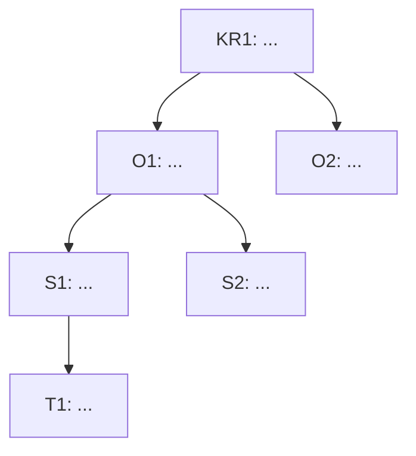

# Etapa 3B (opcional) — Árvore de Oportunidades: [iniciativa]

**Entrada:** `02-estrategia.md`, `03-modelagem.md` e `contexto.md`

Estrutura: Resultado (Key Result) → Oportunidades (dores e necessidades do usuário) → Soluções candidatas → Testes de suposição.

## Árvore

## Oportunidades

Cada oportunidade é descrita do ponto de vista do usuário e vinculada a uma dor do Módulo 1 e a um estágio da Jornada To-Be.

| # | Oportunidade | Key Result | Dor (Módulo 1) | Estágio da jornada | Frequência | Severidade |
| :--- | :--- | :--- | :--- | :--- | :--- | :--- |
| O1 | | KR_ | P_ | J_ | Alta / Média / Baixa | Alta / Média / Baixa |

## Soluções candidatas

Ao menos duas soluções por oportunidade priorizada, para permitir comparação.

| # | Solução | Oportunidade | Suposição mais arriscada | Teste de suposição | Decisão |
| :--- | :--- | :--- | :--- | :--- | :--- |
| S1 | | O_ | | | Segue para Feature Frame / Descartada / Aguardando teste |

## Saída para o Módulo 4

| Solução selecionada | Feature Frame | Justificativa da escolha |
| :--- | :--- | :--- |
| S_ | FF-_ | |
